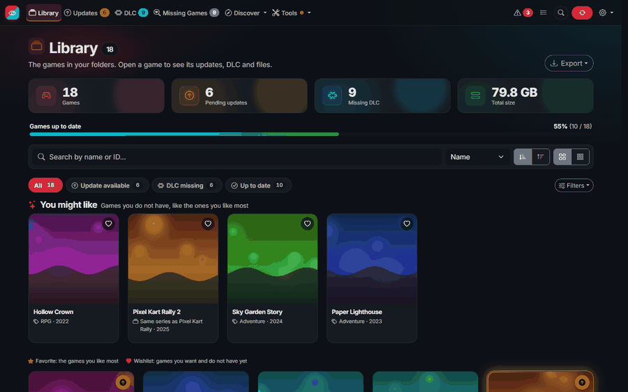
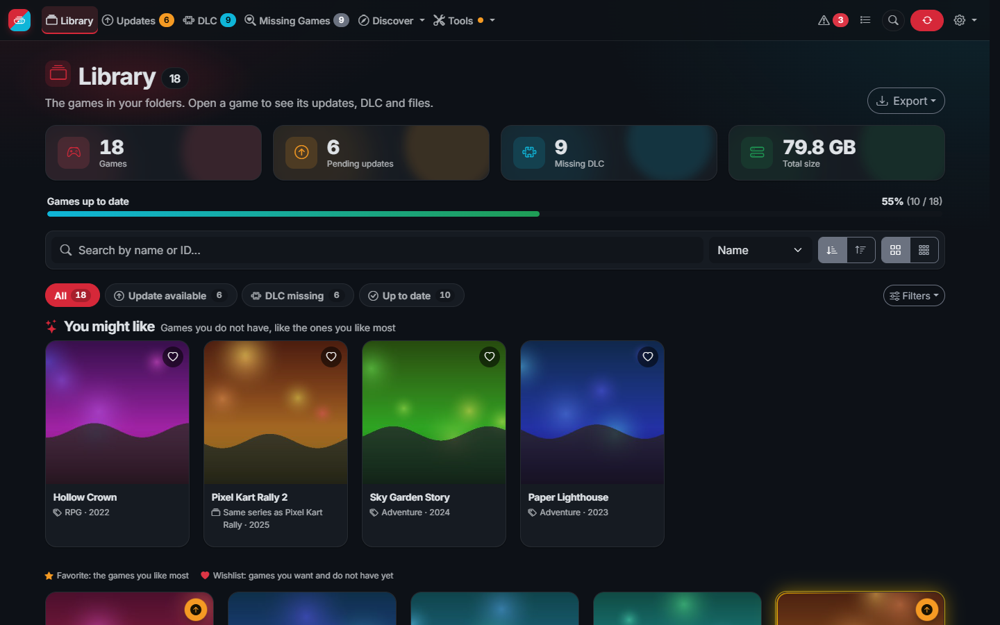
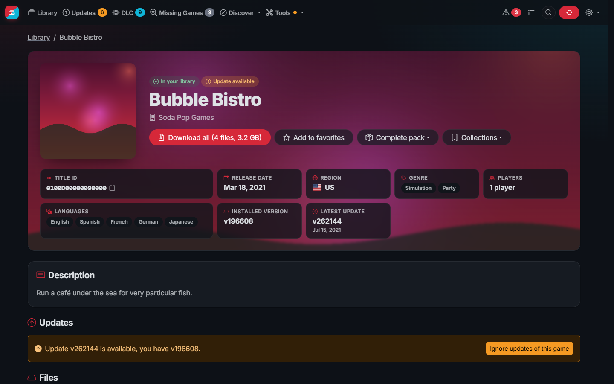
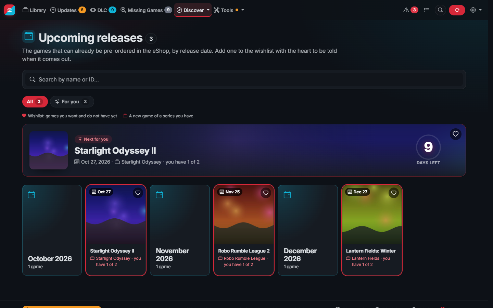
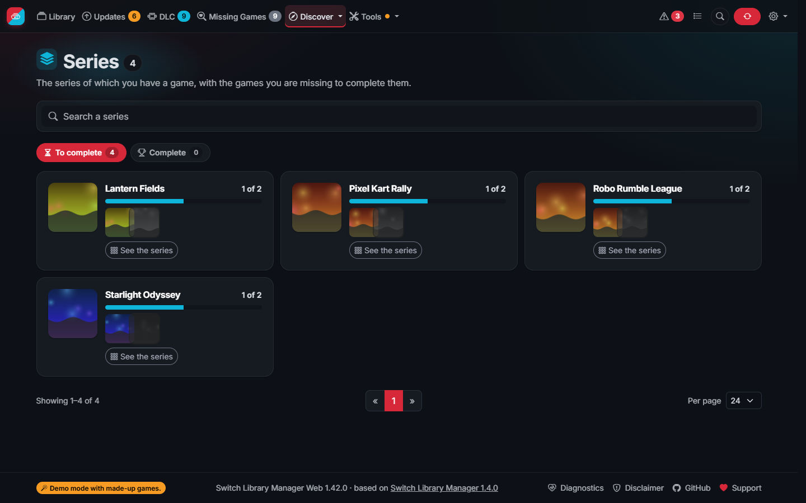
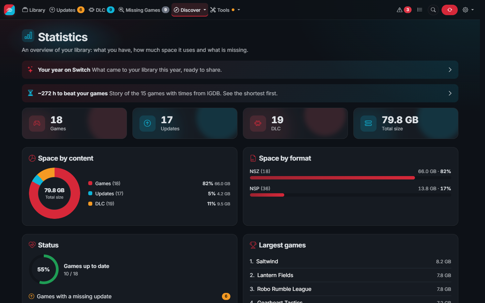
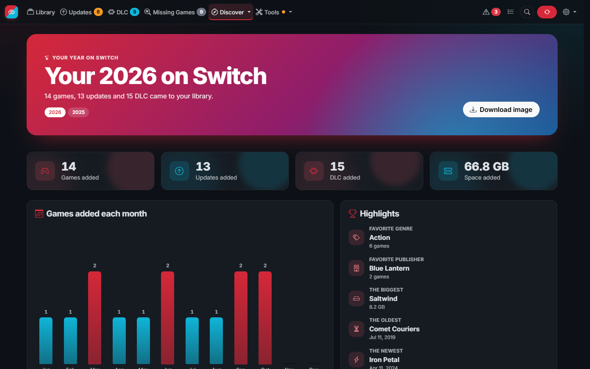
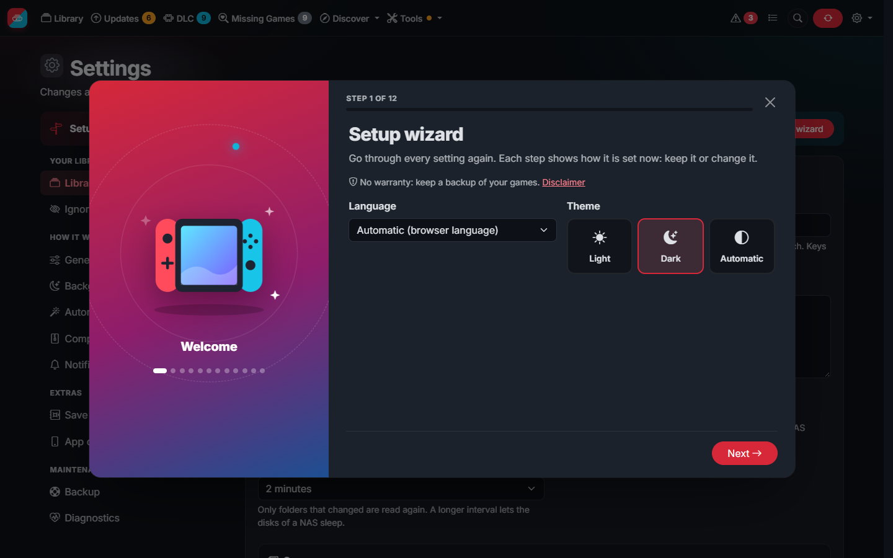
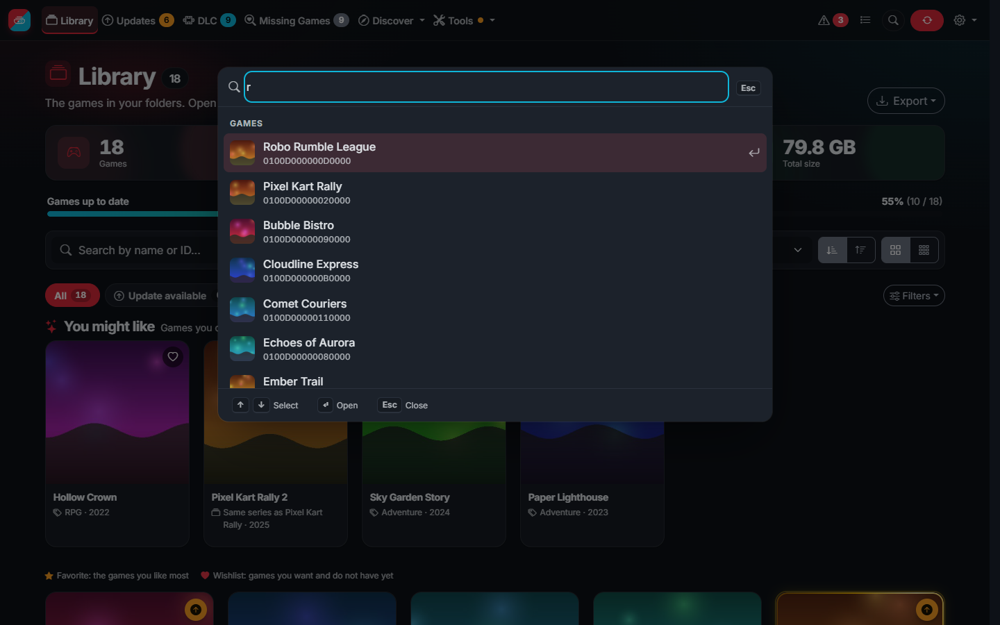

# Switch Library Manager Web

[](https://ko-fi.com/delfus77)
[](https://github.com/DeLFuS77/switch-library-manager-web/releases)
[](https://hub.docker.com/r/delfus77/switch-library-manager-web)
[](https://github.com/DeLFuS77/switch-library-manager-web/actions/workflows/test.yml)
[](https://www.bestpractices.dev/projects/15629)
[](https://scorecard.dev/viewer/?uri=github.com/DeLFuS77/switch-library-manager-web)
[](https://github.com/DeLFuS77/switch-library-manager-web/blob/master/LICENSE)

Manage the backups of your Nintendo Switch games from the browser: see which updates, DLC and games you are missing,
find broken or duplicate files, keep your folders tidy and save space with NSZ compression. It runs on Windows, macOS,
Linux, Docker, NAS and Raspberry Pi.

<p align="center">
  <a href="https://ko-fi.com/delfus77"></a>
  <br>
  <sub>❤️ Free and open source, and it will stay free. If it saves you time, a coffee helps keep it going.</sub>
</p>

> Built on the work of [@giwty](https://github.com/giwty), who created
> [Switch Library Manager](https://github.com/giwty/switch-library-manager), [@dtrunk90](https://github.com/dtrunk90),
> who made [its web version](https://github.com/dtrunk90/switch-library-manager-web), and
> [@trembon](https://github.com/trembon), whose [fixes](https://github.com/trembon/switch-library-manager) are included.
> Thank you! See [Thanks](#thanks) and [NOTICE](NOTICE.md).

> [!IMPORTANT]
> This project contains **no keys, no games and no copyrighted content**, and it never downloads them. Use it only
> with backups of games you own. The few features that read the content of your files use **your own** `prod.keys`,
> which you dump from **your own console** with a key dumping tool and keep on your computer: keys are never
> included, uploaded or shared. Never post your keys anywhere, also not in issues, logs or screenshots.

<p align="center">
  
</p>

<table>
  <tr>
    <td width="50%" align="center"><br><sub>The library: covers, missing updates and DLC, recommendations</sub></td>
    <td width="50%" align="center"><br><sub>A game page: facts, times to beat, versions and DLC</sub></td>
  </tr>
  <tr>
    <td width="50%" align="center"><br><sub>Upcoming releases, with your wishlist and series first</sub></td>
    <td width="50%" align="center"><br><sub>Series: how many games of each one you have</sub></td>
  </tr>
  <tr>
    <td width="50%" align="center"><br><sub>Statistics of your library</sub></td>
    <td width="50%" align="center"><br><sub>Your year on Switch, ready to share</sub></td>
  </tr>
  <tr>
    <td width="50%" align="center"><br><sub>The setup wizard of the first start</sub></td>
    <td width="50%" align="center"><br><sub>Quick search from any page (Ctrl+K)</sub></td>
  </tr>
</table>

<sub>The tour and the screenshots show the demo mode: the games, publishers and covers are made up.</sub>

## Contents

- [Features](#features)
- [Quick start](#quick-start): [Docker](#docker), [NAS](#synology-portainer-and-unraid), [Windows, macOS and Linux](#windows-macos-and-linux)
- [Your keys](#your-keys)
- [Documentation](#documentation): the [wiki](https://github.com/DeLFuS77/switch-library-manager-web/wiki) has every guide
- [Disclaimer](#disclaimer), [License](#license) and [Thanks](#thanks)

## Features

**Your library at a glance**
- Scans your folders (NSP, NSZ, XCI, XCZ and split files) and rescans by itself when files change
- Missing updates (for games and DLC), missing DLC and missing games, with filters and search
- Library filters by status, genre, players, language, format, region, collection, games or demos, and games
  without a cover; sort by size, date added or time to beat; a search that forgives typos
- Quick search from any page (<kbd>Ctrl</kbd>+<kbd>K</kbd>, <kbd>/</kbd> or the magnifier in the header): games,
  series, collections, pages and sections of Settings, chosen with the arrows and opened with Enter
- Game pages with description, screenshots, DLC, downloads (a whole game as one ZIP) and the **version history**:
  every update with its date, the one installed, and a link to what is new
- Favorites, your own collections of games ("Playing", "For the kids"...) and actions on several games at once
- SD card planner: the games that fit on a card by what you like, copied to the card in one go

**Discover**
- **You might like**: games you do not have, like the ones you like most
- **Upcoming releases**: a calendar of the games coming out, with your wishlist and the sequels of your series first
- **Series**: how many games of each series you have and which ones are missing
- A wishlist of games you do not have yet, with a notification when they come out
- **Times to beat** (optional, from [IGDB](https://www.igdb.com)): how long each game takes, quick, story and 100%,
  and how many hours your library adds up to

**Save vault**
- Keep the backups of your saves on your server: **JKSV** on the console uploads them over WebDAV, a ZIP per backup,
  matched to the games of your library, with their history, downloads, a limit of backups per game and a message for
  every new one. Off until you turn it on

**Cheats**
- The games with cheats for the version you have are marked, with a filter; the game page lists them and gives them
  ready for the SD card, and the whole library at once in one ZIP. From [switch-cheats-db](https://github.com/HamletDuFromage/switch-cheats-db),
  downloaded once a day at most; it can be turned off in Settings

**Statistics**
- Charts of your library: space by content and format, genres, publishers, years, the largest games and its history
- **Your year on Switch**: what came to your library in a year (games, updates, DLC, the busiest month, your
  favorite genre and more), ready to download as an image and share
- Export as CSV, JSON or a web page to share

**Like a console**
- Move through the app with a **game controller**: the D-pad or the stick go from card to card, A opens, B goes back
  and Start searches, with a cursor on the chosen card that breathes like on a console
- **Couch mode** (in testing) for a TV: everything bigger, the whole screen and the covers first
- Optional interface sounds, like the menu of a console, off until you turn them on

**Keep it tidy**
- Issues: unsupported, duplicate, old, damaged or unidentified files
- Organize files in folders and rename them from templates, always with a preview first
- Delete old updates, duplicates and empty folders, choosing which copy of a duplicate stays: the NSP or NSZ, the XCI
  or XCZ, or the one the app picks (a file with several titles is never deleted while it holds something the
  library keeps)
- Ignore lists for DLC, updates and file types; hide demos
- **Automations** (off until you turn them on): new files are checked, compressed, the updates they replace deleted
  and the library organized by itself, with a message of what was done

**Save space**
- Compress NSP to NSZ and XCI to XCZ (10 to 60% smaller), installed directly by installers such as DBI;
  convert XCI to NSP
- Every file is verified before the original is deleted; NSZ files can be decompressed back to NSP
- See how much each file will likely save before compressing it, from what your earlier compressions saved
- Pause a compression and resume it later, from the same point in the middle of a file
- Several files at once, with the threads and files measured on your own server to compress as fast as it can
- Complete packs: the game, its latest update and its DLC in one NSP (or NSZ) to install at once, without the
  delta fragments of the update, from a game page or for many games at once; checked before the separate files are
  deleted, only if you choose it
- Split multi-title files ("SuperNSP", packs made here or by other tools) back into one NSP or NSZ per game, update
  and DLC, in bulk, without decompressing or changing what they hold; a cartridge with several games into one XCI or XCZ per game
- Space page: see how much old updates, duplicates and already compressed originals take, and free it safely
- The same game from several regions (each with its own title ID): the copy to keep is suggested (your language,
  more languages, newer update, more DLC, not damaged, already compressed) and the others are deleted in one click

**Built to run on a server, or on your computer**
- A setup wizard on the first start, and again from Settings whenever you want
- Docker image for amd64 and arm64, templates for Unraid, Synology and Portainer, and ready-to-run programs for
  Windows, macOS, Linux and Raspberry Pi
- Low memory use and fast with tens of thousands of files: the library shows up while it is scanned, covers and
  thumbnails load in the background
- Background hours: keep cover downloads, thumbnails, file checks and compression for the night
- Live tasks page, scheduled synchronization and notifications (Discord, Telegram, webhook) of new updates, DLC
  and games
- Weekly backups of your configuration, and a Diagnostics page that checks everything at a glance
- JSON API with OpenAPI description, e.g. for Home Assistant
- Installable on your phone's home screen like an app
- Accessible: the contrast of WCAG AA in both themes, full use with the keyboard and texts of 12px at least, checked
  on every change

**Safe to reach from the internet**
- User accounts with administrator and read-only roles, a language per user and an activity log
- Protection against brute force and bots that try lists of users and passwords, also behind Cloudflare
- No access from outside your network until an administrator exists; HTTPS-ready, with the usual browser
  protections

**In your language**
- English, Spanish, French, German, Italian, Portuguese, Dutch, Russian, Japanese, Korean and Chinese (including
  game names where the eShop has them), light and dark theme

## Quick start

### Docker

The image is on [Docker Hub](https://hub.docker.com/r/delfus77/switch-library-manager-web) as
`delfus77/switch-library-manager-web` (also `ghcr.io/delfus77/switch-library-manager-web`), for amd64 and arm64.

With Docker Compose, download [docker-compose.yml](https://github.com/DeLFuS77/switch-library-manager-web/blob/master/docker-compose.yml), set the folder of your games and run
`docker compose up -d`. Or with `docker run`:

```
docker run -d \
  --name switch-library-manager-web \
  --restart unless-stopped \
  -p 3000:3000 \
  -e PUID=1000 -e PGID=1000 -e TZ=Europe/Madrid \
  -v /path/to/appdata:/usr/local/share/switch-library-manager-web \
  -v /path/to/your/switch/games:/mnt/roms \
  delfus77/switch-library-manager-web
```

Then open http://localhost:3000 (or the address of your server).

| Setting | Meaning |
|---|---|
| `-p 3000:3000` | The port of the web interface |
| `/usr/local/share/switch-library-manager-web` | Data folder: settings, caches, covers and **your keys** |
| `/mnt/roms` | Your games; writable, to organize and compress files |
| `PUID`, `PGID` | The user and group that own your games (`id` on the host). The app never runs as root |
| `TZ` | Your time zone, for dates and scheduled synchronizations |

To update, pull the new image and recreate the container: `docker compose pull && docker compose up -d`.

### Synology, Portainer and Unraid

| System | How |
|---|---|
| Synology (DSM 7.2+) | Container Manager project: [templates/synology/docker-compose.yml](templates/synology/docker-compose.yml) |
| Portainer | App template URL: `https://raw.githubusercontent.com/DeLFuS77/switch-library-manager-web/master/templates/portainer.json` |
| Unraid | Search for **Switch Library Manager** in the **Apps** tab |

Step by step for each one in [Installing on a NAS](docs/install/nas.md) and in the [wiki](https://github.com/DeLFuS77/switch-library-manager-web/wiki/Installation).

On **Unraid**, set **Switch library** to the share with your games (for example `/mnt/user/switch`) and copy
your keys to `/mnt/user/appdata/switch-library-manager-web/`. Do not install the image from the Docker Hub search: the
port and folders would be empty.

### Windows, macOS and Linux

Download the file for your system from the [latest release](https://github.com/DeLFuS77/switch-library-manager-web/releases/latest),
unpack it and run the program; nothing has to be installed. There are files for Windows (x64 and ARM), macOS (Apple and
Intel chips), Linux and the Raspberry Pi (64 and 32 bit). The programs are not signed, so the first time Windows or macOS
asks before opening them: see [the steps for each system](https://github.com/DeLFuS77/switch-library-manager-web/wiki/Installation#windows-macos-and-linux).

The program keeps its settings and data next to itself, or in the folder set in `SLM_DATA_DIR`. To update, unpack the
new version over the folder of the one you have (`switch-library-manager-web`): the program is replaced and the data stays.

## Your keys

Keys are optional. Without them games are recognized by their file names, like
`Super Mario Odyssey [0100000000010000][v0].nsp`. With **your own** `prod.keys`, dumped from **your own** console, the
app reads the files themselves, checks them, and can compress, split and pack them. Put it in the data folder, or
upload it from **Settings › Library** or the setup wizard. More in [Keys and first start](https://github.com/DeLFuS77/switch-library-manager-web/wiki/Keys-and-first-start).

## Documentation

The [wiki](https://github.com/DeLFuS77/switch-library-manager-web/wiki) has a guide for everything:

| | |
|---|---|
| [Getting started](https://github.com/DeLFuS77/switch-library-manager-web/wiki/Getting-started) | From installing to a library that keeps itself up to date, step by step |
| [Tour of the app](https://github.com/DeLFuS77/switch-library-manager-web/wiki/Tour-of-the-app) | Every page, with a screenshot and what it is for |
| [Installation](https://github.com/DeLFuS77/switch-library-manager-web/wiki/Installation) | Docker, Synology, Portainer, Unraid, Windows, macOS, Linux, Raspberry Pi |
| [Organize and duplicates](https://github.com/DeLFuS77/switch-library-manager-web/wiki/Organize-and-duplicates) | Folders, names, old updates and which copy of a duplicate stays |
| [Compression](https://github.com/DeLFuS77/switch-library-manager-web/wiki/Compression) | NSZ and XCZ, how files are checked, complete packs and splitting |
| [Cheats](https://github.com/DeLFuS77/switch-library-manager-web/wiki/Cheats) | The cheats of your games for the version you have, ready for the SD card |
| [Users and security](https://github.com/DeLFuS77/switch-library-manager-web/wiki/Users-and-security) | Accounts, the internet, Cloudflare and verifying the downloads |
| [Save vault](https://github.com/DeLFuS77/switch-library-manager-web/wiki/Save-vault), [Times to beat and sagas](https://github.com/DeLFuS77/switch-library-manager-web/wiki/Times-to-beat-and-sagas), [App on your phone](https://github.com/DeLFuS77/switch-library-manager-web/wiki/App-on-your-phone) | The extras |
| [Notifications and API](https://github.com/DeLFuS77/switch-library-manager-web/wiki/Notifications-and-API), [Settings and backups](https://github.com/DeLFuS77/switch-library-manager-web/wiki/Settings-and-backups) | Messages, Home Assistant, `settings.json` |
| [Updating](https://github.com/DeLFuS77/switch-library-manager-web/wiki/Updating), [Troubleshooting](https://github.com/DeLFuS77/switch-library-manager-web/wiki/Troubleshooting), [FAQ](https://github.com/DeLFuS77/switch-library-manager-web/wiki/FAQ), [Glossary](https://github.com/DeLFuS77/switch-library-manager-web/wiki/Glossary) | Help |
| [Demo mode](https://github.com/DeLFuS77/switch-library-manager-web/wiki/Demo-mode), [Building](https://github.com/DeLFuS77/switch-library-manager-web/wiki/Building) | Look around without games, build it yourself |

To report a security problem privately, see [SECURITY.md](SECURITY.md). To report bugs, ask for features or contribute
code, see [CONTRIBUTING.md](CONTRIBUTING.md).

## Disclaimer

Switch Library Manager Web is free software, provided as it is, without any warranty, as its license (AGPL-3.0,
sections 15 and 16) says. It moves, renames, compresses and deletes files only when you ask it to or turn on an
automation, and it checks the files before deleting originals or copies. Even so, no program is free of mistakes and
disks fail: **keep a backup of anything you could not get again**, and look at the previews before applying changes.

The authors and contributors are not responsible for files lost, damaged or deleted, nor for any other harm that comes
from using the app. Using it means accepting this. Use it only with games you own and with keys dumped from your own
console. The app does not download games, and it is not affiliated with Nintendo or endorsed by it.

The same text is in the app, linked from the footer of every page.

## License

The changes made in this repository are published under the [GNU Affero General Public License 3.0](https://github.com/DeLFuS77/switch-library-manager-web/blob/master/LICENSE)
(up to version 1.25.2 they were MIT). You may use, change and share the app freely; if you distribute a changed
version or offer it over a network, its source code must stay available under the same license. The projects this
fork is based on did not publish a license, so their code remains under the copyright of their authors; see
[NOTICE](https://github.com/DeLFuS77/switch-library-manager-web/blob/master/NOTICE.md).

### Thanks

❤️ The app is free and will stay free. If it saves you time, you can support its development with a tip on
[Ko-fi](https://ko-fi.com/delfus77): it is entirely voluntary and unlocks nothing. Starring the repository and reporting bugs
help too.

- Based on [giwty's switch-library-manager](https://github.com/giwty/switch-library-manager) and
  [dtrunk90's switch-library-manager-web](https://github.com/dtrunk90/switch-library-manager-web)
- Parsing, organizing and title data fixes from [trembon's switch-library-manager](https://github.com/trembon/switch-library-manager)
- Title data from [blawar's titledb](https://github.com/blawar/titledb)
- Cheats from [HamletDuFromage's switch-cheats-db](https://github.com/HamletDuFromage/switch-cheats-db), mirrored from GBAtemp and
  the authors of each cheat
- NSZ format of [nsz](https://github.com/nicoboss/nsz) and the [Inter](https://github.com/rsms/inter) font
- Everyone who reports bugs, like [@LonelyTV](https://github.com/LonelyTV) ([#3](https://github.com/DeLFuS77/switch-library-manager-web/issues/3))
